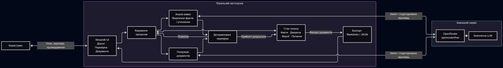
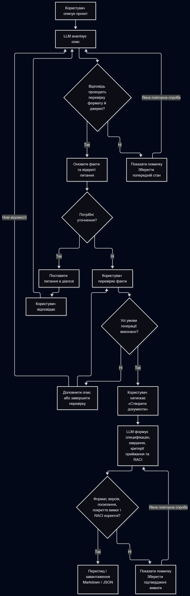

# Помічник бізнес-аналітика: звіт про прототип

## Задача та межі

Користувач описує програмний проєкт природною мовою. Помічник збирає мету, користувачів, вимоги, обмеження та ролі команди; виявляє прогалини й суперечності; ставить уточнення; після людської перевірки створює специфікацію, завдання з критеріями приймання та RACI.

Прототип — локальний вебзастосунок на Python і Streamlit, LLM викликається через OpenRouter. RAG не використовується: цінність системи в керуванні діалогом, походженні кожного факту, людському підтвердженні та перевірці узгодженості документів.

## Компоненти та потік даних

*Рисунок 1. Високорівнева архітектура помічника бізнес-аналітика.* UI, стан, перевірки та експорт працюють локально; аналіз і генерація звертаються до LLM через OpenRouter. Analyzer і Generator — логічні компоненти з різними промптами, не окремі сервери чи автономні агенти. Стрілки показують основні потоки, а не кожний виклик функції.

*Рисунок 2. Процес уточнення вимог і формування документів.* Показано цикли уточнення, людську перевірку, умови генерації та явні повторні спроби після помилок. Перевірка джерел і посилань є структурною, не гарантією семантичної правильності. У UI факти можна переглядати до завершення всіх уточнень, але генерація лишається заблокованою до виконання всіх умов.

| Компонент | Вхід → вихід | Виклики та контроль |
|---|---|---|
| Analyzer, `analyzer_v3` | Повідомлення, поточні факти й питання → факти з цитатами, уточнення, пропозиції вирішення | Один LLM-запит на дію; цитати мають існувати в повідомленнях користувача; модель не підтверджує факти |
| Session / Workflow | Валідована відповідь і дії людини → нова версія стану | Детермінований Python; оновлення атомарні, застарілі документи анулюються |
| Умови генерації | Стан перевірки → дозвіл або пояснення блокування | Потрібні п'ять підтверджених категорій, завершений аналіз, відсутність непереглянутих фактів і блокувальних питань |
| Generator, `generator_v3` | Підтверджені факти, пропозиції, відкриті неблокувальні питання → ArtifactBundle | LLM створює специфікацію, завдання, критерії та RACI; завдання й RACI позначені рекомендаціями |
| Валідатор та експорт | ArtifactBundle + стан → документи або помилка | Відомі посилання, покриття вимог, рівно один A та щонайменше один R на дію; експорт без ключа й історії чату |
| OpenRouter adapter | Повідомлення + JSON Schema → типізована відповідь або безпечна помилка | `openrouter/free`, нульові цінові фільтри, без tools і plugins; HTTP через httpx |

Вільний маршрутизатор може обирати різні моделі. Ліміт відповіді — 4096 токенів, аналіз — до 60 секунд, генерація — до 180 секунд, типовий режим — одна спроба на дію. Після помилки схеми наступна явна спроба може містити інструкцію виправлення формату. Перевірки не послаблюються. Тексти надсилаються до OpenRouter та провайдера; сеанс і ключ зберігаються в пам'яті. Перезапуск сервера може втратити сеанс.

## CRISP-DM і дані

| Фаза | Виконано | Межа доказів |
|---|---|---|
| Business understanding | Вимоги Assignment.pdf зіставлені з BA-01–07, SYS, EVAL та SUB; обсяг погоджено | Навчальний MVP, без розгортання для реальних замовників |
| Data understanding | До синтетичних даних досліджено PURE, PROMISE NFR, LLMREI, ReqElicitBench | Журнал джерел, придатності й ліцензій у [плані оцінювання](../evals/PLAN.md) |
| Data preparation | 12 розмічених знімків: 8 dev, 4 reserved test; перевірка хешів, цитат і поділу сімейств | Усі 12 розміток переглянуто й погоджено вручну |
| Modeling | Два версійовані LLM-компоненти, строгі контракти, діалог, UI, експорти; ітерація промптів v2 → v3 за результатами аналізу помилок | Зміни промптів зафіксовані хешами; модель free-маршруту змінюється між запитами |
| Evaluation | 144 регресійні тести; baseline v2, аналіз помилок, повторне оцінювання v3 (3 dev-прогони, 1 reserved test після freeze) | Мала вибірка, 1–3 повтори, модель free-маршруту змінюється між запитами |
| Deployment | Локальний запуск через uv; інструкції запуску й перевірок у README | Перевірено на чистому клоні з GitHub: встановлення, тести, перевірки й запуск сервера; розгортання поза локальною машиною не планувалось |

Два dev-приклади адаптовані з публічного LLMREI; решта dev і весь reserved test — синтетичні. Повні вихідні діалоги не включені до репозиторію. Джерело LLMREI: DOI 10.5281/zenodo.15016930; рішення та обмеження ліцензування зафіксовані в журналі дослідження. Gold не передається runtime-моделі. Резервні сценарії не використані для налаштування промптів.

## Наскрізний приклад

Початковий опис: скоротити ручне опрацювання заявок; користувачі — працівники; створення заявки; локальна мережа; один розробник. Уточнення визначили поля заявки, доступ лише до власних заявок, вхід, відсутність редагування й зміни статусів, спосіб створення облікових записів та роль замовника.

Після перевірки користувач отримав експорт стану 19: 19 підтверджених тверджень, з них 6 вимог, 7 розділів специфікації, 9 завдань і 9 дій RACI. Приклад ланцюжка: REQ-006 задає поля й автоматичні атрибути заявки → TASK-004 реалізує її створення з перевіркою обов'язкових полів → ACT-004 призначає розробнику R/A, замовнику C/I. Це простежуваність артефактів, а не доказ реалізації системи заявок.

## Оцінювання та помилки

Оцінювання пройшло повний цикл: baseline v2 → аналіз помилок → зміни лише в промптах → freeze хешів → повтор тих самих dev-випадків і один прогін reserved test.

| Метрика | v2 | v3 | Висновок |
|---|---:|---:|---|
| F1 наявності категорій, dev (збої = порожній прогноз) | 20% | 71.8% | Факти більше не губляться; коливання між прогонами дають збої провайдера |
| Те саме, лише успішні виклики | 40% | 96.6% | Лишилась одна хибна «мета» в 1/3 прогонів |
| F1, reserved test | — | 76.9% | Gold переглянуто людиною після прогону, мітки без змін |
| Конфлікт знайдено й обидві сторони збережено | 0/1 | 4/4 | Головну помилку v2 виправлено |
| Bundle проходить усі структурні перевірки | 0/1 | 2/7 спроб | Найкращий: 6/6 вимог, 8/8 завдань, приймання замовником |

Деталі v3, всі спроби й залишкові помилки: [ітерація v2 → v3](../evals/runs/components-v3-2026-11-15.md). Головні залишкові помилки v3: хибна «мета» з назви проєкту в 1 з 3 прогонів, розмите «потрібен сервіс» записане як вимога, одна пропущена вимога на тесті. Найбільша практична проблема — нестабільність безплатного маршруту (429, швидкі HTTP 400, обрізані відповіді).

Відтворювані команди наведено в README. Регресія: 144/144 тести, зокрема на чистому клоні з GitHub; Ruff, перевірки середовища, датасету й freeze пройшли, Streamlit відповів HTTP 200. Тести перевіряють валідатори, стан, обробку помилок API (mocked HTTP) і UI (Streamlit AppTest), але не якість моделі; її оцінюють live-прогони.

Нижче — детальний опис першого прогону (baseline v2), з якого почалась ітерація; повний запис: [baseline v2](../evals/runs/components-2026-11-15.md).

| Об'єкт | Метрика / перевірка | Результат baseline v2 |
|---|---|---|
| Виділення фактів | Micro precision/recall **наявності категорій**, не семантичний fact F1 | На трьох dev-входах TP=1, FP=1, FN=7: P=50%, R=12.5%, F1=20%; збій 502 рахується порожнім прогнозом |
| Прогалини й уточнення | Правильний блокувальний конфлікт; якісний перегляд доречності питань | Конфлікт знайдено в 1/1 позитивному випадку, але 0/2 вихідних фактів збережено; ключове уточнення доречне |
| Специфікація | Відомі посилання розділів; змістова відповідність | 5/5 розділів мають відомі джерела, але частина формулювань посилює/неповно відображає факти |
| Завдання | Покриті вимоги; коректні посилання | 5/6 вимог, 4/11 завдань з допустимими requirement_ids; bundle відхилено. Попередній наданий документ мав 6/6 і 9/9 |
| RACI | Один A, щонайменше один R, відомі ролі та завдання | 11/11 дій проходять; окреме приймання замовником не представлене (у v3 з'явилось) |
| Adapter / Workflow / UI | Регресійні тести успішних дій та відмов | Перевіряються mocked HTTP та Streamlit AppTest; без оцінки доступності реального провайдера |
| Експорт | Читабельність, збереження змісту та безпечне екранування | Виправлені апострофи й повторення описів ролей; повторно надані користувачем файли підтвердили зміни |

Типові спостережені збої: 429, timeout, зайві/відсутні поля JSON, specification як рядок замість списку, відсутній duties. Відповідь не застосовується як успішна; попередні підтверджені дані зберігаються. Формат уточнено прикладом у промпті, час генерації відокремлено від аналізу, фіксовану модель замінено безплатним маршрутом. Збої не зникли: у прогонах v3 вони лишаються головною причиною втрат.

У контрольованому прогоні schema-valid відповіді отримано для 3/4 викликів, analyzer прийняв 2/3; третій повернув 502. Generator повернув schema-valid JSON за 48.961 с, але порушив контракт посилань і не покрив одну вимогу. Маршрутизатор обрав nvidia/nemotron-3.5-super-vl:free, particle-ai/particle-1:free та dots-studio/dots-3-note-preview:free; модель невдалої спроби не повернута. Usage трьох відповідей повідомляє cost=0; дані невдалої спроби відсутні. Це не оцінка стабільності за чотирма запитами.

Після перегляду результатів було погоджено три головні помилки baseline: хибна «мета», пропущені суперечливі факти й неправильні посилання/неповне покриття завдань. Саме вони стали основою змін у v3.

## Instructional Markdown і skills

`AGENTS.md` визначає мову, порядок читання контексту, перевірки й межі автономності. STATUS зберігає актуальний стан, REQUIREMENTS — критерії, ARCHITECTURE — контракти та рішення. Локальні skills є процедурами розробки; runtime-модель їх не виконує.

| Skill | Фактичний приклад | Результат і перевірка |
|---|---|---|
| crisp-dm-step | Дослідження даних перед синтетичними сценаріями | Журнал джерел, поділ dev/test, явні незавершені критерії; див. evals/PLAN.md |
| evaluate-component | Ітерація v2 → v3: baseline, аналіз помилок, зміна промптів, freeze, повторний прогін | Окремі записи baseline/candidate з однаковими випадками й знаменниками; збої провайдера лишаються в метриках |
| review-deliverable | Перевірка експорту й підготовка до здачі | Регресійні перевірки апострофів/RACI, перегляд змін, перевірка на чистому клоні (знайдено й виправлено розбіжність хешів через CRLF) |

Вплив skills підтверджується створеними артефактами й перевірками, а не вигаданим порівнянням продуктивності «зі скілами / без скілів».

## Висновок і наступні кроки

Прототип реалізує повний цикл: діалог і уточнення → людська перевірка фактів → генерація специфікації, завдань і RACI, які перевіряє код. Одна ітерація оцінювання підняла F1 аналізатора з 20% до 72% на dev і дала повністю валідні пакети документів.

Обмеження: нестабільність безплатних моделей, мала вибірка, метрика на рівні категорій, а не окремих фактів, і лише сеансове збереження.
